# headless-reaper
[English](README.md)

실행한 프로그램이 종료된 뒤 남은 헤드리스 브라우저를 찾아 정리하는 명령줄 도구입니다. 기본 실행은 목록만 보여 줍니다.

Python 3.9+ · Rust

[](https://pypi.org/project/headless-reaper/)
[](https://github.com/elfenomenokim/headless-reaper/blob/main/LICENSE)

macOS에서 Rust 판은 스캔 11.3ms, 시작 2.9ms입니다. Python 판은 같은 작업에 122.1ms, 36.1ms가 걸립니다. 저장된 20회 측정에서 가져왔습니다.

<picture>
  <source media="(prefers-color-scheme: dark)" srcset="https://raw.githubusercontent.com/elfenomenokim/headless-reaper/main/docs/demo/dark.gif">
  
</picture>

영상은 전용 headless shell을 실행한 부모 프로세스를 먼저 종료한 뒤, 그 브라우저만 찾아 정리합니다. 프로필은 `/tmp` 아래에 있으며 Google Chrome은 실행하지 않습니다. [녹화 소스](docs/demo/light.tape).

## 설치

```sh
pipx install headless-reaper
uv tool install headless-reaper
pip install headless-reaper
```

Python 3.9 이상이 필요합니다. wheel에는 Rust CLI와 Python 라이브러리가 함께 들어 있습니다. 소스 설치에는 Rust가 필요합니다. 독립 실행 파일만 설치하려면 `cargo install --path rust --locked`를 실행하세요.

macOS arm64와 Ubuntu 24.04 arm64에서 남은 브라우저 정리와 살아 있는 부모를 둔 브라우저 보존을 확인했습니다. Windows x64에서는 두 판본 모두 지원하지 않는 플랫폼이라는 응답과 종료 코드 2를 반환합니다.

## 시작하기

먼저 목록을 확인합니다. 아래는 임시 headless shell로 얻은 출력입니다. 환경 변수로 모든 명령의 대상을 해당 프로필 하나로 한정했습니다. 실제 사용할 때는 작업의 프로필 경로로 바꾸세요.

```console
$ export HEADLESS_REAPER_PATH=/tmp/reaper-demo.58q834un

```

```console
$ headless-reaper
headless-reaper 0.1.0: 1 orphaned group, 4 processes, 224.8 MB RSS (1024 processes scanned, paths /tmp/reaper-demo.58q834un)

ROOT   AGE  RSS       PIDS  PROFILE
18952  1s   224.8 MB  4     /tmp/reaper-demo.58q834un
       why: headless, temp profile, remote debugging; launcher gone (reparented to launchd 1)

dry run: nothing was killed. Rerun with --kill to terminate these groups.
```

```console
$ headless-reaper --kill
headless-reaper 0.1.0: 1 orphaned group, 4 processes, 224.8 MB RSS (1024 processes scanned, paths /tmp/reaper-demo.58q834un)

ROOT   AGE  RSS       PIDS  PROFILE
18952  1s   224.8 MB  4     /tmp/reaper-demo.58q834un
       why: headless, temp profile, remote debugging; launcher gone (reparented to launchd 1)

reaped 1 group: sent SIGTERM to 4 of 4 processes, SIGKILL to 0.
```

```console
$ headless-reaper
headless-reaper 0.1.0: no orphaned headless browsers (1024 processes scanned, paths /tmp/reaper-demo.58q834un).
```

마지막 조회에서 대상 브라우저가 사라진 것을 확인했습니다. PID·프로세스 수·RSS는 실행할 때마다 달라집니다.

## 만든 이유

테스트가 비정상 종료되면 브라우저는 남을 수 있습니다. `ps`로 찾더라도 어떤 보조 프로세스가 그 브라우저에 속하는지 다시 확인해야 합니다. 이 도구는 브라우저와 하위 프로세스를 한 그룹으로 묶고, 실행한 부모가 사라졌는지 확인합니다.

평소 종료 처리는 테스트 프레임워크의 브라우저 종료 호출에 맡기세요. 임의의 프로세스를 살피려면 `ps`나 프로세스 모니터가 맞습니다. 이 도구는 알려진 브라우저 이름, 자동화 신호, 종료된 부모라는 조건을 모두 만족하는 잔여 프로세스를 다룹니다. 기본 개인 프로필은 대상에서 제외합니다.

## 측정

2026-11-17에 저장한 측정입니다. 파일 캐시가 따뜻한 상태에서 20회 순차 실행한 중앙값이며, Rust 1.100.0 release 빌드를 썼습니다. 시작 시간은 `--version`, 조회 시간은 `--json --path /tmp/headless-reaper-bench-empty`로 측정했습니다. 경로를 좁혀도 전체 프로세스 표는 읽습니다. 최대 RSS는 `/usr/bin/time`으로 따로 쟀습니다.

| 환경·판본 | 시작 (ms) | 조회 (ms) | 최대 RSS (KiB) |
|---|---:|---:|---:|
| macOS arm64 / Python 3.12.8 | 36.078 | 122.098 | 23,296 |
| macOS arm64 / Rust | 2.856 | 11.315 | 3,136 |
| Ubuntu 24.04 arm64 / Python 3.12 | 68.953 | 76.615 | 15,144 |
| Ubuntu 24.04 arm64 / Rust | 0.841 | 5.564 | 1,892 |

당시 두 컴퓨터의 프로세스 수에 따른 결과입니다. 모든 환경에 같은 시간이 걸린다는 뜻은 아닙니다.

## 옵션

| 옵션 | 기본값 | 동작 |
|---|---|---|
| `--kill` | 꺼짐 | SIGTERM 후 대기, 남은 대상에 SIGKILL |
| `--path PREFIX` | 모든 프로필 | 프로필 경로로 대상 제한, 반복 지정 가능 |
| `--min-age DURATION` | `0` | 더 최근에 시작된 그룹 제외: `30s`, `10m`, `2h`, `1d` |
| `--grace DURATION` | `10s` | SIGTERM과 SIGKILL 사이 대기 |
| `--remove-profiles` | 꺼짐 | `--kill`과 함께 정리 가능한 임시 프로필 제거 |
| `--json` | 꺼짐 | 그룹·합계·정리 결과·오류를 JSON으로 출력 |
| `--clean-clones` | 꺼짐 | macOS 코드 서명 복제본 조회, 삭제하려면 `--kill` 추가 |
| `--all-leftovers` | 꺼짐 | `--kill`, `--clean-clones`, `--remove-profiles` 동시 적용 |

종료 코드 **0**은 조회 성공 또는 대상 전체 정리, **1**은 남은 대상이나 조회 실패, **2**는 사용법 오류 또는 미지원 플랫폼입니다.

환경 변수는 `HEADLESS_REAPER_PATH`, `HEADLESS_REAPER_MIN_AGE`, `HEADLESS_REAPER_GRACE`입니다. macOS/Linux에서 여러 경로는 `:`로 구분합니다. 명령줄 옵션이 환경 변수보다 우선하며 별도 설정 파일은 없습니다.

### 대상 판정

<picture>
  <source media="(prefers-color-scheme: dark)" srcset="https://raw.githubusercontent.com/elfenomenokim/headless-reaper/main/docs/diagrams/reap-flow-dark.ko.svg">
  
</picture>

정리 대상은 알려진 자동화 브라우저이며, 부모가 종료됐고 경로·나이 조건에 맞아야 합니다. 기본 개인 프로필은 제외합니다. KILL은 대기 후에도 남은 프로세스에만 보냅니다.

Chrome/Chromium·Edge·Firefox·WebKit 계열의 주 프로세스만 그룹 시작점이 됩니다. 렌더러나 보조 프로세스는 제외합니다. `--headless`, 임시·자동화 프로필, 또는 해당 프로필과 원격 디버깅 옵션이 있어야 합니다. 부모는 PID 1, init 계열 프로세스이거나 프로세스 표에서 사라진 상태여야 합니다.

하위 프로세스는 같은 그룹으로 묶습니다. 신호를 보내기 전에 시작 시간을 비교해 PID가 다른 프로세스에 재사용됐는지 확인합니다. 기본 개인 프로필과 부모가 살아 있는 브라우저는 제외합니다.

### 프로필과 복제본 정리

`--remove-profiles`는 `--kill`이 필요합니다. 임시 폴더 밖의 프로필, 살아 있는 브라우저가 쓰는 프로필, 유효한 singleton 잠금이 있는 프로필, 정리 후 생존 프로세스가 남은 그룹의 프로필은 보존합니다.

macOS의 `--clean-clones`는 현재 사용자의 X 임시 폴더에서 알려진 브라우저의 `code_sign_clone.*` 폴더만 살핍니다. 기본 최소 나이는 10분입니다. 디렉터리 심볼릭 링크와 사용 중인 파일은 보존합니다. 하드 링크를 구분하려고 경로뿐 아니라 device/inode도 비교합니다. 열린 파일 조회에 실패하면 삭제하지 않습니다.

표시 크기와 할당 블록, 정리 전후의 여유 공간 변화는 서로 다릅니다. APFS 공유 블록 때문에 표시 크기를 회수 가능한 용량으로 보면 안 됩니다. `--path`는 브라우저 프로필만 제한하며 복제본 검색 위치를 바꾸지 않습니다. 다른 운영체제에서는 복제본 전용 모드가 아무 작업도 하지 않습니다.

### Python

```python
import time
from headless_reaper import find_groups, list_processes

groups = find_groups(list_processes(), now=time.time(),
                     min_age=600, paths=("/tmp/my-test",))
for group in groups:
    print(group.root.pid, group.profile, group.rss_bytes())
```

`reap(groups)`로 그룹을 종료하고 `cleanup_profiles(groups)`로 임시 프로필을 정리합니다. `clean_clones(kill=False, min_age=600)`는 macOS 복제본을 조회합니다. Python CLI를 직접 고르려면 `python -m headless_reaper`를 실행하세요.

## 한계

- launchd나 systemd가 직접 실행한 브라우저도 부모가 종료된 것처럼 보입니다. `--path`로 대상을 한정하세요. 나이만으로 소유 작업을 구분할 수는 없습니다.
- WebKit은 실행 인수 판정만 확인했습니다. 테스트 환경에 GTK 4가 없어 실제 브라우저는 실행하지 못했습니다.
- macOS/Linux x86_64 백엔드는 실행하지 않았습니다. Windows 브라우저 백엔드는 없습니다.
- Python의 macOS 구현은 `ps`를 읽으므로 공백이 든 프로필 경로를 정확히 복원하지 못할 수 있습니다. Rust는 `KERN_PROCARGS2`, Linux의 두 판본은 `/proc`에서 인수를 읽습니다.
- 홈 폴더의 사용자 지정 프로필로 열린 자동화 창은 부모가 종료돼도 남을 수 있습니다. 원격 디버깅 옵션만으로는 정리 대상이 되지 않습니다.

## 기여

버그나 실행 결과는 [이슈](https://github.com/elfenomenokim/headless-reaper/issues)에 남겨 주세요. 소스 확인 명령: `cargo test --manifest-path rust/Cargo.toml`. 확인 항목과 리뷰 방식은 [CONTRIBUTING.md](CONTRIBUTING.md), 작업 구조와 주의사항은 [AGENTS.md](AGENTS.md)에 있습니다.

## 라이선스

MIT입니다. [LICENSE](LICENSE)를 보세요.

비공식 도구이며 Google·Mozilla·Microsoft 및 여기서 언급한 브라우저 자동화 프로젝트와 제휴 관계가 없습니다.
