# headless-reaper
[한국어](README.ko.md)

A command-line tool that finds and stops orphaned headless browsers, with a dry run by default.

<picture>
  <source media="(prefers-color-scheme: dark)" srcset="https://raw.githubusercontent.com/elfenomenokim/headless-reaper/main/docs/demo/dark.gif">
  
</picture>

The demo starts a dedicated headless shell from a short-lived parent, then reaps that browser's `/tmp` profile. It never launches Google Chrome. [Recording source](docs/demo/light.tape).

## Install

```sh
pipx install headless-reaper
uv tool install headless-reaper
pip install headless-reaper
```

Python 3.9+. Wheels install the Rust CLI and an importable Python reference. Source installs need Rust; `cargo install --path rust --locked` installs the standalone command.

| Platform | Observed behavior |
|---|---|
| macOS arm64 | Orphan detection and cleanup; live-parent browser preserved |
| Ubuntu 24.04 arm64 | Chromium and Firefox orphan cleanup; live-parent browser preserved |
| Windows x64 | Both editions exit 2: browser reaping is unsupported |

## Quick start

Start with a dry run. These outputs came from a disposable headless-shell process. The environment variable limits every command to that one profile; replace the path with your own job's profile directory.

```console
$ export HEADLESS_REAPER_PATH=/tmp/reaper-demo.58q834un

```

```console
$ headless-reaper
headless-reaper 0.1.0: 1 orphaned group, 4 processes, 224.8 MB RSS (1024 processes scanned, paths /tmp/reaper-demo.58q834un)

ROOT   AGE  RSS       PIDS  PROFILE
18952  1s   224.8 MB  4     /tmp/reaper-demo.58q834un
       why: headless, temp profile, remote debugging; launcher gone (reparented to launchd 1)

dry run: nothing was killed. Rerun with --kill to terminate these groups.
```

```console
$ headless-reaper --kill
headless-reaper 0.1.0: 1 orphaned group, 4 processes, 224.8 MB RSS (1024 processes scanned, paths /tmp/reaper-demo.58q834un)

ROOT   AGE  RSS       PIDS  PROFILE
18952  1s   224.8 MB  4     /tmp/reaper-demo.58q834un
       why: headless, temp profile, remote debugging; launcher gone (reparented to launchd 1)

reaped 1 group: sent SIGTERM to 4 of 4 processes, SIGKILL to 0.
```

```console
$ headless-reaper
headless-reaper 0.1.0: no orphaned headless browsers (1024 processes scanned, paths /tmp/reaper-demo.58q834un).
```

The second scan confirms that the scoped browser is gone. Process counts, PIDs and RSS will differ on your machine.

## Why

A crashed test can leave its browser running after the test process is gone. You can find it with `ps`, but deciding which helpers belong to it takes another step. `headless-reaper` groups the browser tree and checks whether its launcher still exists before proposing cleanup.

Use your test framework's browser-close call for normal teardown. Use `ps` or a process monitor when you need to inspect arbitrary processes. This tool handles leftovers: it requires a recognized browser, an automation signal, and a missing launcher. A default personal profile is excluded.

## Measurements

Saved measurements from 2026-11-17: median of 20 sequential subprocess runs, warm filesystem cache, release Rust 1.100.0. Startup ran `--version`; scanning ran `--json --path /tmp/headless-reaper-bench-empty` and still read the whole process table. Peak RSS came from a separate `/usr/bin/time` scan. These are two hosts and their process populations, not a claim about every machine.

| Platform / edition | Startup (ms) | Scan (ms) | Peak RSS (KiB) |
|---|---:|---:|---:|
| macOS arm64 / Python 3.12.8 | 36.078 | 122.098 | 23,296 |
| macOS arm64 / Rust | 2.856 | 11.315 | 3,136 |
| Ubuntu 24.04 arm64 / Python 3.12 | 68.953 | 76.615 | 15,144 |
| Ubuntu 24.04 arm64 / Rust | 0.841 | 5.564 | 1,892 |

## Reference

| Option | Default | Meaning |
|---|---|---|
| `--kill` | Off | SIGTERM, wait, then SIGKILL for surviving targets |
| `--path PREFIX` | All profiles | Limit profile paths; repeat for several prefixes |
| `--min-age DURATION` | `0` | Skip younger groups; accepts `30s`, `10m`, `2h`, `1d` |
| `--grace DURATION` | `10s` | Wait between SIGTERM and SIGKILL |
| `--remove-profiles` | Off | With `--kill`, remove eligible temporary profiles |
| `--json` | Off | Report groups, totals, cleanup results and errors as JSON |
| `--clean-clones` | Off | Inspect unused macOS code-signing clones; add `--kill` to delete |
| `--all-leftovers` | Off | Combine `--kill`, `--clean-clones` and `--remove-profiles` |

Exit **0** means a dry run succeeded or all targets were reaped. Exit **1** means a target survived or inspection failed. Exit **2** means invalid usage or an unsupported platform.

`HEADLESS_REAPER_PATH`, `HEADLESS_REAPER_MIN_AGE`, and `HEADLESS_REAPER_GRACE` set defaults. Paths use `:` as the separator on macOS/Linux. Flags override environment values. There is no configuration file.

### Target selection

<picture>
  <source media="(prefers-color-scheme: dark)" srcset="https://raw.githubusercontent.com/elfenomenokim/headless-reaper/main/docs/diagrams/reap-flow-dark.svg">
  
</picture>

An eligible target is a recognized automation browser whose launcher is gone and whose path and age match your scope. Personal default profiles are excluded. KILL is only for processes surviving the grace period.

A root must be a recognized Chrome/Chromium, Edge, Firefox, or WebKit browser process, not a renderer or helper. It must carry `--headless`, a temporary or automation profile, or remote debugging together with such a profile. Its parent must be PID 1, an init process, or missing from the snapshot.

The tool groups descendants under the root. Before signalling, it compares process start times to avoid signalling a recycled PID. It excludes default personal profiles and browsers whose launcher is alive.

### Profile and clone cleanup

`--remove-profiles` requires `--kill`. Cleanup preserves a profile outside temporary roots, one still used by a live browser, one with a live singleton lock, or one whose group left a survivor.

On macOS, `--clean-clones` examines recognized browser `code_sign_clone.*` directories under the current user's X temp directory. It uses a ten-minute minimum age unless you set one. Directory symlinks and live uses are preserved; matching includes device/inode identity because clones may share hard links. An open-file scan failure prevents deletion.

Clone reports distinguish apparent size, allocated blocks, and observed free-space change. Shared APFS blocks mean apparent size is not reclaimable space. `--path` filters browser profiles; it does not change the fixed clone scope. Clone-only mode does nothing on other operating systems.

### Python

```python
import time
from headless_reaper import find_groups, list_processes

groups = find_groups(list_processes(), now=time.time(),
                     min_age=600, paths=("/tmp/my-test",))
for group in groups:
    print(group.root.pid, group.profile, group.rss_bytes())
```

`reap(groups)` terminates selected groups; `cleanup_profiles(groups)` handles their temporary profiles. `clean_clones(kill=False, min_age=600)` performs a macOS clone dry run. `python -m headless_reaper` selects the Python CLI explicitly.

## Limits

- A browser launched directly by launchd or systemd looks orphaned. Scope cleanup with `--path`; an age threshold alone does not establish ownership.
- WebKit's argument detection was checked, but a live WebKit browser was not exercised because the test host lacked GTK 4.
- macOS/Linux x86_64 backends were not exercised. Windows has no browser backend.
- The Python macOS backend reads `ps` output and cannot recover profile paths containing spaces reliably. Rust reads exact argv through `KERN_PROCARGS2`; Linux reads `/proc` in both editions.
- A visible automation browser with a custom home-directory profile can remain after its launcher exits. The detector does not treat every remote-debugging browser as disposable.

## Contributing

Issues and platform reports are welcome; run `cargo test --manifest-path rust/Cargo.toml` from the source checkout. See [AGENTS.md](AGENTS.md) for the code layout and safety rules.

License: [MIT](LICENSE).

Unofficial; not affiliated with Google, Mozilla, Microsoft, or the browser automation projects mentioned here.
